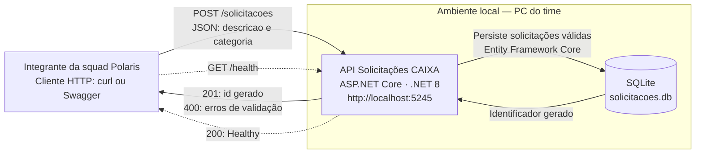
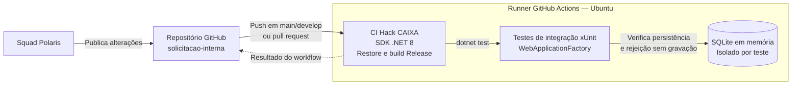

# Diagrama de contexto — Solicitações CAIXA

## Execução local do Hack

O integrante da squad envia requisições HTTP para a API. A criação de uma
solicitação usa SQLite; o health verifica apenas se a API está em execução.

### Leitura do diagrama

- **Ator:** integrante da squad, usando ferramentas HTTP. Não há interface
  de negócio implementada; o Swagger é uma ferramenta disponível em `Development`.
- **Sistema:** API responsável por validar e cadastrar solicitações internas.
- **Persistência:** arquivo SQLite dentro do ambiente local, sem servidor
  de banco externo. Os dados permanecem entre reinicializações.
- **Setas contínuas:** fluxo de criação e persistência.
- **Setas tracejadas:** health check, sem consulta ao SQLite.
- A porta **5245** corresponde ao perfil `http`; se alterada, os clientes
  precisam usar a nova URL.

O `400` de validação não grava dados. O diagrama mostra o fluxo de sucesso da
persistência, não o tratamento de falhas de infraestrutura.

## Apoio ao desenvolvimento — GitHub Actions

O CI é separado do fluxo de uso da API. Ele compila e executa testes no runner
do GitHub; não chama a API que está rodando no PC do time.

O banco em memória é usado pela aplicação hospedada nos testes de integração;
o health não o consulta. Nenhum teste acessa o arquivo SQLite do PC do time.
O resultado verde só valida o commit daquela execução, não alterações locais
ainda não publicadas.

## Referências

- [README: contrato, execução e evidências](../README.md).
- [ADR-001: decisões e limites](adr/ADR-001.md).
- [OpenAPI: endpoints e schemas](openapi.yaml).
- [Cenários de teste](cenarios-teste.md).
