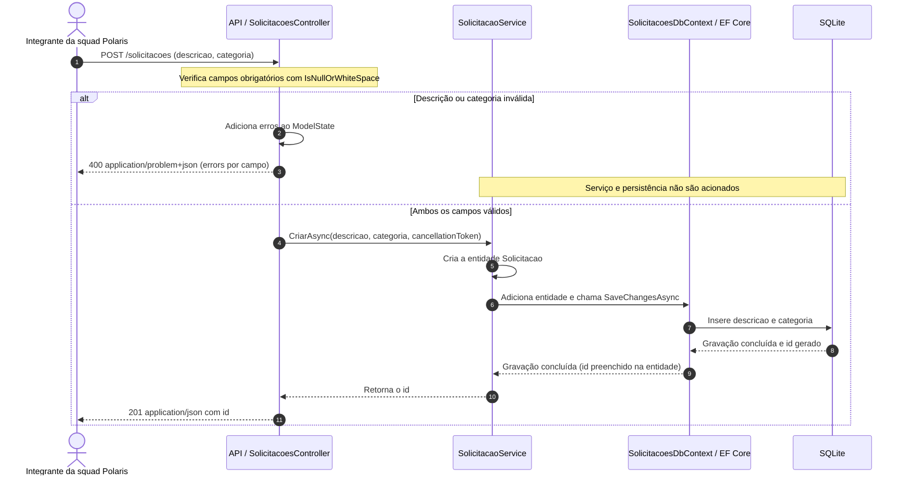
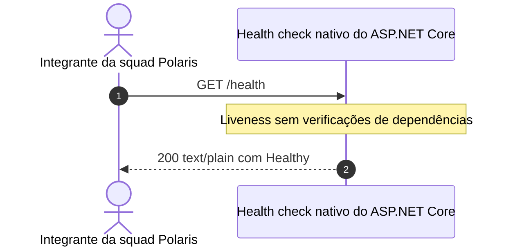

# Fluxo de eventos — Solicitações CAIXA

Este documento descreve a sequência de **requisições HTTP e persistência** da
API do Hack. Não há publicação de eventos de domínio, filas ou processamento
em segundo plano na implementação atual.

## 1. Inicialização da API

Antes de receber requisições:

1. A aplicação carrega a configuração e registra o DbContext, o serviço,
   os controllers e o health check.
2. Cria um escopo e chama `SolicitacaoService.InicializarAsync`.
3. `EnsureCreatedAsync` inicializa o banco SQLite e o schema quando necessário,
   sem migrations ou atualização de um schema já existente.
4. A aplicação passa a atender HTTP; no perfil `http`, a URL é
   `http://localhost:5245`.

Uma falha na inicialização do banco impede a subida da API. Essa etapa não
é executada novamente a cada POST ou chamada ao health.

## 2. Cadastro — `POST /solicitacoes`

O diagrama começa com um JSON que foi aceito pelo model binding. A API valida
os campos antes de acionar o serviço.

### Entrada e validação

- O cliente envia `Content-Type: application/json`.
- `descricao` e `categoria` são strings obrigatórias.
- Campo ausente, `null`, vazio ou somente espaços em branco gera erro.
- Se ambos forem inválidos, a resposta contém os dois erros.
- JSON malformado, corpo ausente ou tipos incompatíveis podem ser rejeitados
  pelo model binding com `400`, antes de executar a ação do controller.
- Tipo de conteúdo não suportado pode resultar em `415`.

### Persistência e resposta

- Os valores válidos são gravados como recebidos, sem remoção de espaços.
- O serviço aguarda `SaveChangesAsync` antes de devolver o identificador.
- O `id` gerado é um inteiro de 64 bits; a resposta expõe apenas esse campo.
- Repetir o POST válido cria outra solicitação; não existe deduplicação.
- O `CancellationToken` recebido pelo controller é repassado até a gravação.
- Falhas de infraestrutura não têm tratamento customizado que garanta um
  corpo padronizado. O `201` do diagrama pressupõe gravação bem-sucedida.

## 3. Disponibilidade — `GET /health`

Esse fluxo não passa pelo `SolicitacoesController`, pelo serviço de criação
ou pelo SQLite. Um health positivo não substitui o smoke de persistência.

## 4. Smoke local com dados fictícios

| Etapa | Requisição | Resultado esperado | Efeito no banco |
| --- | --- | --- | --- |
| Health | `GET /health` | `200`, corpo `Healthy` | Nenhum |
| Criação válida | POST com descrição e categoria fictícias | `201`, corpo com `id` positivo | Cria uma solicitação |
| Criação inválida | POST com categoria ausente | `400`, erro em `errors.categoria` | Nenhum |

Os comandos, payloads e evidências da execução estão no
[README](../README.md). As chamadas prontas estão em
[API_Solicitacoes.http](../API_Solicitacoes/API_Solicitacoes.http).
Não execute o smoke contra banco de produção.

## Referências

- [Diagrama de contexto](diagrama-contexto.md): atores e fronteiras do sistema.
- [ADR-001](adr/ADR-001.md): decisões, limites e pendências.
- [OpenAPI](openapi.yaml): contrato das requisições e respostas.
- [Cenários de teste](cenarios-teste.md): verificações automatizadas existentes.
